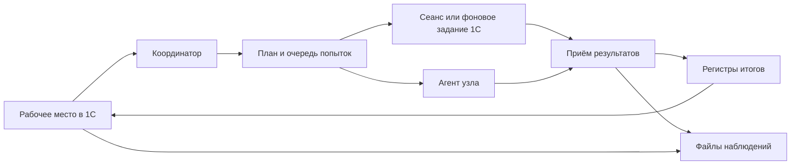

# Архитектура диагностической конфигурации

[Главная](../README.md) · [Каталог 90 проб](tests/README.md) · [Протокол измерений](tests/protocol.md) · [Словарь измерений](data-model.md) · [Баллы и связи проб](scoring.md)

**Проект решения для EDT, совместимость 8.3.25.** Оператор выбирает стенд и пробы, видит доступные исполнители, запускает измерения и сравнивает результат с эталоном. Каждое число в отчёте раскрывается до версии методики, фактических условий и исходного наблюдения.

## Что взять из существующих инструментов

| Источник | Практика | Решение для проекта |
|---|---|---|
| [Google Benchmark](https://github.com/google/benchmark/blob/main/docs/user_guide.md) | Контекст запуска, число итераций, прогрев, независимые повторения, единицы и пользовательские счётчики | Сохранять длительность серии и число выполненных операций. Вычисляемые нс/итерацию сопровождать разрешением исходного таймера |
| [Airspeed Velocity](https://asv.readthedocs.io/en/stable/using.html) | История по машине, окружению и ревизии, возможность неполного покрытия | Показывать тренд сопоставимых точек, оставлять пропуски и объяснять изменение условий |
| [1С:Тест-центр](https://v8.1c.ru/tekhnologii/tekhnologii-krupnykh-vnedreniy/korporativnye-instrumenty/korporativnyy-instrumentalnyy-paket/test-tsentr/) | Многопользовательский сценарий задаёт воспроизводимую деятельность | Профиль задаёт темп, число сеансов и порядок фаз. Независимый сеанс-наблюдатель выполняет контрольную пробу |
| [СКД платформы 1С](https://v8.1c.ru/platforma/sistema-komponovki-dannykh/) | Декларативные наборы данных, отборы, группировки и расшифровки | Паспорт стенда и история работают по компактным регистрам итогов. Переход к первичным данным выполняется из строки отчёта |

## Где проходит измерение

Одна конфигурация поддерживает два размещения. При разработке можно совместить управление и тестовые данные в одной ИБ, буферизуя замеры до конца серии. Для испытаний записи, блокировок, кэшей и смены процессов использовать отдельную управляющую ИБ и тестовую ИБ с предметными данными. При испытании общего дискового пути разместить архив результатов и управляющую запись вне этого пути либо отложить выгрузку до окончания измерения. Две ИБ на одном томе по-прежнему конкурируют за диск.

В рабочем дереве уже есть товары, склады, документ движения, регистр остатков, генератор данных и серверные функции проб. Эти объекты составляют **измеряемую нагрузку**. Метаданные ниже составляют проект управления экспериментами и историей. YAxUnit проверяет правильность кода и импорта. Показатели производительности получают из запусков на идентифицированном стенде. [Модуль проб](../edt/benchmark/src/CommonModules/БенчмаркПробы/Module.bsl)

## Каталог и модель хранения в 1С

Методика имеет постоянный код-строку с ведущими нулями (`026`). В Git хранятся текст карточки, декларация параметров, перечень метрик и соответствие разрешённому обработчику. При поставке конфигурация импортирует декларации в каталог. На первом этапе декларации нужны для реализованных проб, остальные карточки доступны со статусом «описана». Редактируемые оператором профили и эталоны живут в ИБ. Журнал в Markdown служит для публикации отобранных примеров со ссылкой на прогон. Повседневная история собирается автоматически.

| Объект метаданных (предложение) | Что представляет одна запись | Ключевые данные |
|---|---|---|
| Справочник Пробы | Одна методика | Код, группа, название, ссылка на карточку, доступность реализации. Версия методики, ID и версия реализации, требования к узлу, схема параметров и метрик фиксируются при запуске |
| Справочники Стенды и ПрофилиИспытаний | Именованный стенд и повторно используемый план | Роли узлов, допустимые исполнители. В табличной части профиля — проба, вариант, параметры, ступени, прогрев и повторы. У профиля есть ревизия |
| Документ ПрогонИспытаний без проведения | Одно намерение оператора выполнить зафиксированный план | UUID, автор, время UTC, стенд, состояние, снимок окружения и развёрнутого профиля, ревизия кода, версия формата. После старта снимки неизменяемы |
| Независимый непериодический РС ПопыткиПроб | Одно фактическое выполнение одной точки плана | Измерения: прогон, ID точки, номер независимого повтора, номер попытки. Поля: проба, вариант, заданная ступень, исполнитель, статус, причина, начало/конец, номер принятой попытки определяется состоянием |
| Независимый непериодический РС ПоказателиПопыток | Одно скалярное значение в контексте попытки или агрегат повторов | Ключ попытки либо нулевой ключ сводного итога + код метрики + статистика + ID ряда (узел, PID или направление). Число, единица, число наблюдений, применимость, версия агрегатора. Для точного большого счётчика задавать разрядность при регистрации метрики |
| Независимый РС АртефактыПопыток | Один файл или чанк ряда | Ключ попытки, тип, номер части, URI, SHA-256, байты, формат, доступность, срок хранения. Артефакт всего прогона привязать к манифесту прогона |
| РС Эталоны | Назначение конкретного валидного результата эталоном | Стенд/класс стендов, проба, вариант, ключ сопоставимости, ссылка на утверждённый прогон и точки, автор, дата, ревизия назначения |

Точка плана однозначно задаёт пробу, вариант и ступень. ID точки общий для её повторов внутри прогона. Для поиска аналогичной точки в другом прогоне строится ключ из смысловых полей. Дату 1С использовать для навигации по истории. Высокоточные смещения и длительности хранить числами с единицей, источником часов и разрешением.

**Граница между регистрами и файлами.** В регистрах оставляем то, по чему строятся отборы, сравнения и графики ступеней. Небольшой снимок параметров сериализуется один раз. Для высокочастотных BSL-наблюдений сохранять агрегаты попытки, чтобы запись результатов не вмешивалась в измеряемый интервал. Приложение не запускает внешние утилиты и не импортирует внешние измерительные пакеты. Если механизм требует данных, которые BSL не может получить, это ограничение фиксируется в карточке, а результат не выдумывается.

Ввести индексы под два запроса: «все точки выбранного прогона» и «завершённые прогоны стенда по пробе и периоду». Форму сравнения строить по итогам выбранных попыток. Список прогонов и сводка не должны читать архив. Для переносимости экспортировать пакет из манифеста, снимков, числовых итогов и доступных артефактов с относительными путями и хешами. Резервное копирование охватывает ИБ и архив. Для истёкшего файла сохранять запись с пометкой «удалён по сроку». Закреплённые эталоны защищать от обычной очистки с указанием занимаемого объёма.

## Контракт и ход исполнения

1. **Планирование.** Координатор разворачивает профиль в точки и повторы, фиксирует параметры, seed, порядок A/B, бюджеты, требуемые роли узлов и ресурсы. Неподдерживаемые проверки получают причину пропуска. Отдельно сохраняются заявленные возможности агента и реально включённые счётчики.
2. **Подготовка.** Исполнитель получает ID попытки, версию разрешённого обработчика и параметры. Для BSL это диспетчер известных серверных функций, для UI — тестовый клиент, для SQL и нативных проб — адаптер соответствующего узла. Произвольные команды в профиль не включаются. Планировщик исключает пересечение несовместимых прогонов на одном ресурсе. Намеренную конкуренцию внутри пробы задаёт её план.
3. **Измерение.** Фазы — подготовка, прогрев, измерение, восстановление, очистка. В измеряемой секции только нужная работа и минимальный локальный сбор. Для многосессионной пробы есть барьер готовности, запланированное и фактическое начало. PID, узел, достигнутая ступень и контрольная сумма записываются как факты. Телеметрия других машин имеет источник времени, интервал и погрешность синхронизации.
4. **Доставка.** Минимальный пакет содержит schema_version, run_id, point_id, repeat_no, attempt_no, probe_id, implementation_id, версии, фазу, фактическое окружение, измерения, контроль результата и манифест файлов. У метрики есть постоянный код, единица, смысл (длительность, счётчик, скорость), область и правило агрегации. Недоступная метрика имеет причину пропуска. Нулевое значение сохраняет обычный числовой смысл.
5. **Фиксация.** Сначала файлы попадают во временную область и проверяются по хешу. Координатор публикует неизменяемые файлы, затем в одной транзакции под блокировкой ключа попытки сохраняет манифест, итоги и конечный статус. Повтор доставки того же пакета возвращает прежнюю квитанцию. Иное содержимое под тем же ключом — конфликт. Непривязанные файлы очищаются с отсрочкой.
6. **Отмена и сбой.** Попытка проходит состояния «ожидает → выдана → выполняется → завершена / ошибка / отменена / недействительна». У выдачи есть срок и уникальный токен. После потери связи помечать исход неопределённым. Перед повтором записи проверить состояние тестовых данных, очистку и завершение прежнего исполнителя. Повтор получает новый номер и токен. Поздний пакет не заменяет принятую попытку. В агрегат входит одна валидная попытка на независимый повтор. Число ошибок, повторов и незавершённых работ показывать отдельно.

Права разделить по действиям: чтение отчётов, запуск разрешённых профилей, управление агентами и назначение эталонов. Агент читает задания для своего стенда. Полные техжурналы и параметры запросов доступны по отдельному праву. При экспорте выбирать артефакты и удалять учётные данные из снимков подключения.

## Что оператор видит в конфигурации

| Рабочее место | Основной вопрос | Отображение и действие |
|---|---|---|
| Каталог | Что здесь можно проверить? | Группа → проба. Колонки «описана», «есть реализация», «доступна на стенде», «последний валидный замер». В карточке видны управляющий фактор, единица и контроль. Команда «Добавить в профиль» |
| Прогон | Что сейчас выполняется? | План со ступенями и повторами, выбранные узлы, ожидание исполнителя, прогресс, ошибка или причина пропуска. Раскрытие до попытки и артефактов |
| Паспорт стенда | Где уже наблюдается предел? | Строка на пробу. Покой, последняя успешная и первая проваленная ступени, бюджет, фактический пик и запас при наличии пика. Отдельные колонки для качества измерения и силы диагностического вывода |
| Сравнение | Что изменилось между A и B? | Выбрать два прогона либо текущий и закреплённый эталон. Сначала различия окружений, затем парные строки «метрика / ступень / A / B / абсолютная и относительная дельты / разброс / решение». Из строки открыть исходные повторы |
| История пробы | Когда возникло отклонение? | Отбор по стенду, реализации и варианту. На оси времени — результаты независимых прогонов, метки изменений окружения и пропуски. Для теста со ступенями переключение на кривые «нагрузка → задержка» |

Для списка и табличных отчётов достаточно управляемых форм и СКД. Расчёт сравнения выполняет один серверный модуль для формы и экспорта. Кривые строятся по упорядоченной числовой оси с единицами. Временной ряд отдельного прогона подгружается по выбранному диапазону.

### Правила сравнения

- Проверять совпадение смысла метрики, единиц или их точного преобразования, версии методики, реализации, типа таймера, режима кэша, входных данных, модели нагрузки и сопоставимой ступени. Снимок среды дополнительно содержит версии платформы и СУБД, топологию, квоты, путь тома и включённые сборщики.
- Для регрессионного сравнения задаётся **исследуемое различие**, например версия платформы. Его показывать над таблицей. Прочие существенные расхождения блокируют автоматический вердикт по затронутой пробе. Оператор может открыть значения рядом с пояснением. Разная версия кода допустима при неизменной методике и явном сравнении ревизий.
- Для валидных точек вычислять B − A и 100 × (B − A) / A. При A = 0 показывать только абсолютную дельту. У метрики задано направление улучшения. Пропуск с одной стороны виден отдельной строкой. Времена разных фаз и p95 разных выборок не складывать.
- По умолчанию показывать значения каждого независимого повтора и их медиану. Для серии задержек p95 вычислять по первичным успешным операциям либо совместимым объединяемым гистограммам с указанием точности. Раздельно показывать таймауты и долю ошибок по всем запланированным операциям. Пять повторов пакетного расчёта не дают p95 отдельных итераций.
- Порог практически значимого изменения задаётся для метрики. Превышение бюджета, отличие от эталона и подтверждение механизма — три самостоятельных результата. Для автоматического вывода о регрессии проверять достаточность независимых повторов и устойчивость эффекта относительно межсерийного разброса. До калибровки правила выводить наблюдаемую дельту и статус «требуется повтор».
- Смена эталона явная. Сохранённое сравнение ссылается на конкретные результаты A и B, версию правил и бюджет. Пересчёт новым алгоритмом создаёт новую ревизию заключения.

## Два сквозных примера

**026 · Скорость BSL.** Прогретый BSL-пакет адаптивно увеличивается до измеримого интервала, затем выполняются семь серий с проверкой контрольной суммы. Результат включает нс/итерацию, скорость итераций и условные МГц BSL по явно заданной базе. Это расчётная шкала выполнения BSL, а не измерение аппаратной частоты. Проба 026 оценивается в общем балле; фиксированная проба 001 остаётся контрольной. [Методика 026](tests/rphost/026.md) · [Методика 001](tests/cpu/001.md)

**027 · Базовая цена серверного вызова.** В основном запуске клиентская форма собирает пять серий по двадцать пустых вызовов. Каждое среднее серии и медиана пяти серий отдельно сохраняются в v1-регистрах. Нулевой интервал помечается как ниже разрешения соответствующего миллисекундного таймера; обе медианы также выводятся в текущей таблице как контекстные строки, вне общего балла. RTT включает диспетчеризацию и клиент-серверный путь. PID и системные счётчики не собираются. [Методика 027](tests/rphost/027.md)

**042 · Последовательный файловый ввод-вывод BSL.** Серверный модуль средствами `FileStreams`, `DataWriter` и `DataReader` трижды записывает 64 МиБ и читает тот же объём из временного файла; сверяет контрольные байты, считает длительность и МиБ/с, а затем удаляет файл. Каждая операция записывается в v1-регистры попыток, рядов и показателей и дублируется в `РезультатыФайловойПроб042` для текущего экрана и сравнения. Исторический регистр прежней 042 оставлен отдельно и не смешивается с новой методикой. Результат характеризует файловый API 1С и текущий серверный временный путь с влиянием кэша ОС. Это не тест физической задержки устройства и не подтверждение конкуренции параллельных операций. [Методика 042](tests/storage/042.md)

## Очерёдность реализации и приёмка

1. **Вертикальный срез 026.** Каталог, один профиль, снимок стенда, документ прогона, попытки и скалярные итоги. В форме выполнить два прогона, выбрать эталон, раскрыть разницу до контрольных сумм и длительностей. Изменение профиля после запуска сохраняет прежнюю историю.
2. **BSL-файловая проба 042.** Исполнитель, типизированное хранение точек, автоматический запуск с формы, просмотр результата и API сравнения реализованы. Для приёмки на стенде требуется проверить совместимость встроенных потоков, контроль данных, работу очистки и сохранение результата после повторов; платформенного рантайма в текущем окружении нет.
3. **Многосессионная проба и паспорт.** Барьеры, общий ресурс, таймауты и очистка на примере управляемой блокировки 062. Добавить тренды, сроки хранения, экспорт и остальные адаптеры по мере реализации проб. [Методика 062](tests/transactions/062.md)

Готовность архитектуры к расширению проверяется несколькими BSL-маршрутами — одиночный вызов, измеряемые BSL-порции и несколько координируемых сеансов. Для новой пробы нужно зарегистрировать методику, параметры, вычисляемые показатели и точную границу вывода. Сигналы ОС и гипервизора вне доступности BSL не входят в поток результатов. [Граница измерений только BSL](tests/bsl-only-capabilities.md)
